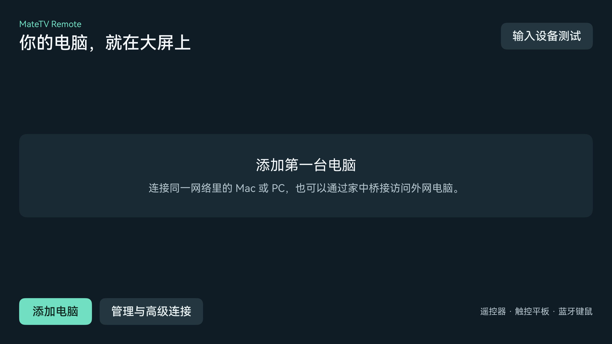

# Huawei MateTV Remote Desktop

在 HarmonyOS MateTV 上查看和控制自己的 Mac、Windows 电脑。电视端采用原生 ArkUI，桌面端使用 RustDesk；外网连接可以复用已有的 Tailscale 网络。

**开发中，部分实机能力已验证。** 用户已确认 Mac 画面、一键连接、显示器切换、自然拖动和反复切换电脑可用，Windows 也已能控制。修复光标图层拦截后，用户确认 Mac 单击和拖动明显恢复正常。文字发送、Windows 双屏及真正外网环境仍待完整验收。日志曾确认 H.265 硬件低延迟解码，实际编码和帧率以当前会话为准。



## 连接方式

- 局域网：MateTV → 电脑的 RustDesk 直接 IP 访问端口。
- 外网：MateTV → 家中常开设备上的固定目标 TCP 桥接 → Tailscale → 外网电脑的 RustDesk。
- 电视无需安装 Tailscale。桥接设备和外网电脑加入同一个 tailnet，使用 Tailscale 的访问规则限制目标端口。
- 桥接仅转发 TCP，不代替 RustDesk 的身份验证，也不提供屏幕采集或鼠标注入。

## 电视操作

- 遥控器和触控平板：短按单击，上下轻扫滚动；按住并停留约 350 毫秒后移动，开始拖拽，松开释放；静止长按至少 600 毫秒再松开触发右键，拖动不会同时右击。当前固件把轻扫和按压转换成相同类型的单指触摸，使用停留时间判别；外接物理鼠标不受此规则影响。
- 默认等比例“短边铺满”：竖屏填满电视宽度、超宽屏填满高度，超出部分用圆形摇杆移动。按住拨杆向需要的方向推，偏移越大移动越快，松手回中但画面位置保持。只有超出画面的方向可以移动。
- 左上角不再显示工具栏。默认左下角纵向放置设置、完整画面／铺满、切屏图标；切屏仅在有多个在线显示器时出现，点一次切到下一屏。返回键退出会话。右下角默认放摇杆，麦克风在其上方；没有溢出画面时只显示麦克风。
- 设置 →“角落按钮布局”提供示意图和文字。功能按钮、语音／摇杆两组可分别选择左上、右上、左下、右下，以及横向或纵向排列；选择会保存，同角位置自动错开。
- 显示设置分别提供分辨率、码率策略、显示器和编码，并显示实际帧率、码率、倍率、延迟。默认 H.265 优先、“与电脑一致”、“不设固定码率上限”（30 帧上限）；高带宽模式请求官方允许的最高质量倍率，实际码率仍随画面和网络自适应，RustDesk 1.5.0 没有指定 Mbps 硬上限接口。
- “与电脑一致”让软件解码保留源像素，上限约 829 万像素、最长边 8192，覆盖 4K 和 5120×1440。软解吃力时可独立选择最长边 1600 的输出，调整码率不会再改变此选项；硬件解码沿用源图像。设置中另有“原始像素”显示比例，避免把源像素放大；提高码率不能增加原始像素数。
- 固定密码成功认证并保存后，点电脑卡片直接连接；密码失效时回到正常认证界面。
- 外接鼠标、键盘沿用上游输入路径，尚待完整客户端实测。
- 文字输入先在电脑上选择光标位置，再点麦克风图标打开右侧文字小窗。唤起系统键盘后，**长按遥控器语音键**听写，检查后点“输入到电脑”。不会自动按回车。
- 实测固件中，输入框和系统键盘已激活时，长按语音键可把文字填入输入框；收起系统键盘后，语音键会唤起小艺，不能继续听写。文字小窗打开时，桌面临时按完整画面缩放，并请求系统键盘压缩可用区域；系统键盘尺寸由输入法决定。

## 项目组成

| 目录 | 内容 |
| --- | --- |
| `tv/overlay` | 大屏电脑列表、输入诊断页 |
| `tv/fragments` | 远程会话中的角落控件、文字草稿、输入适配 |
| `scripts/prepare_client.py` | 获取固定上游版本并应用适配 |
| `scripts/create_diagnostic_project.py` | 生成可独立安装的输入诊断工程 |
| `bridge` | Python 标准库实现的固定目标 TCP 转发 |
| `tests` | 转发、白名单、半关闭与空闲连接测试 |
| `docs` | 安装、构建和实机验收说明 |

客户端基于 [Mydstiny/RemoteDesktopHarmonyOS](https://github.com/Mydstiny/RemoteDesktopHarmonyOS)，固定提交见 `tv/upstream.json`。我们复用其 RustDesk 协议、解码、认证和会话输入实现，避免重新发明远程桌面协议。上游还包含其他协议和功能，它们不属于本项目的电视验收范围。

## 开始使用

1. 阅读 [电脑端与网络配置](docs/setup.md)。
2. 按 [开发和签名](docs/development.md) 生成输入诊断工程，在自己的电视上验证输入。
3. 完整客户端构建、签名后，按 [验收记录](docs/validation.md) 逐项测试。

本仓库不包含签名证书、密码、个人设备地址或预配置的家庭网络。示例配置默认只监听本机。

## 桥接测试

需要 Python 3.12 或更新版本，运行时不依赖第三方包。

```sh
python3 -m unittest discover -s tests -v
python3 -m bridge.server --config bridge/config.example.json --check
```

把示例复制到 gitignored 的 `local/`，填写自己的监听地址、电视白名单和固定目标后再运行：

```sh
mkdir -p local
cp bridge/config.example.json local/bridge.json
# 编辑 local/bridge.json
python3 -m bridge.server --config local/bridge.json
```

## 许可证

AGPL-3.0-or-later，见 [LICENSE](LICENSE) 和 [NOTICE](NOTICE)。上游及原生依赖各自保留版权和许可证。分发修改后的应用时，应提供与该构建对应的完整源代码、补丁和构建说明；不能仅上传一个 HAP 而省略适用的源码义务。本项目与华为、RustDesk、Tailscale 无隶属关系。
